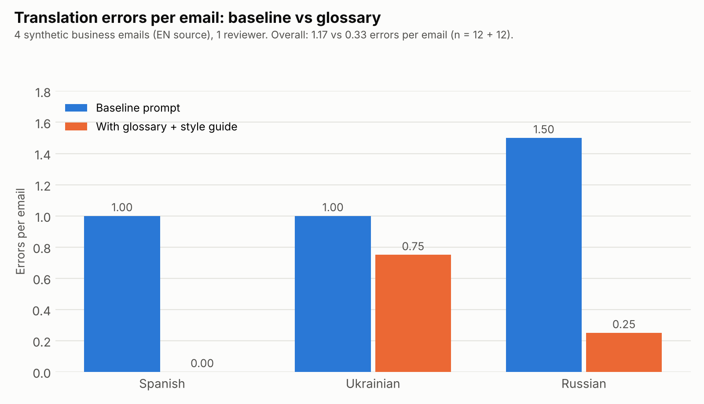

# Multilingual Communication Assistant (EN → ES / UK / RU)

Do a glossary and a style guide make AI translations of business emails better? A test with 24 translations into Spanish, Ukrainian and Russian.

Self-directed prototype. Synthetic data.

## Problem

Offices in Spain often write to clients in several languages. Many clients of gestorías speak Ukrainian or Russian. AI can translate fast, but it can use the wrong terms, the wrong form of address, or add text that should not be in the email.

## Solution

I translated 4 synthetic business emails from English into Spanish, Ukrainian and Russian with two prompts:

- **baseline**: "Translate this email into [language]."
- **with glossary**: a 30-term glossary, a style guide and clear rules.

Then I reviewed all 24 translations myself and logged every error by type and severity. Finally, an AI quality check reviewed the 12 baseline translations, and I compared its findings with mine.

## Tools

Claude Sonnet 5.5 (claude.ai chat, medium setting), Google Sheets.

## Results

| Metric | Baseline | With glossary |
| --- | --- | --- |
| Errors per email | 1.17 | 0.33 |
| Sum of severity points | 15 | 4 |
| AI comments added after the email | 6 of 12 | 0 of 12 |
| Number or date errors | 0 | 0 |

Test size: 4 emails x 3 languages x 2 prompts = 24 translations, 23-24 November 2026, one reviewer.

Main findings:

- With a glossary and a style guide, errors went down about 3 times.
- Without the rule "output only the translation", the AI added comments to half of the emails.
- The AI follows the glossary and the style guide exactly, also when they are wrong. Two of the four glossary errors came from my own files.
- An AI quality check found 9 of my 14 errors and 2 real problems I had missed, but also gave 10 false alarms and 21 unimportant findings. Useful as a second pair of eyes, not as a replacement for a human.

Full report: [docs/report.md](docs/report.md)

## Limitations

4 short emails, one reviewer (native-level Ukrainian and Russian, fluent Spanish), one model for translation and check, my own error categories. The results show a tendency, not a rule. See the report.

## Files

- `data/source/` - 4 synthetic emails in English
- `data/glossary.csv` - 30 terms in EN, ES, UK, RU
- `docs/style-guide.md` - rules for each language
- `prompts/` - baseline and glossary prompts
- `data/output/` - all 24 translations, as returned by the AI
- `data/error_log.csv` - every error, with type and severity
- `data/qa_results.txt` - answers of the AI quality check
- `data/qa_review.csv` - my verdict on every extra AI finding (valid / rule_only / false)
- `images/` - chart

## About

Olga Sorokina - AI automation for accounting and office workflows. Ukrainian, Spanish, Russian, English. Málaga, Spain.
