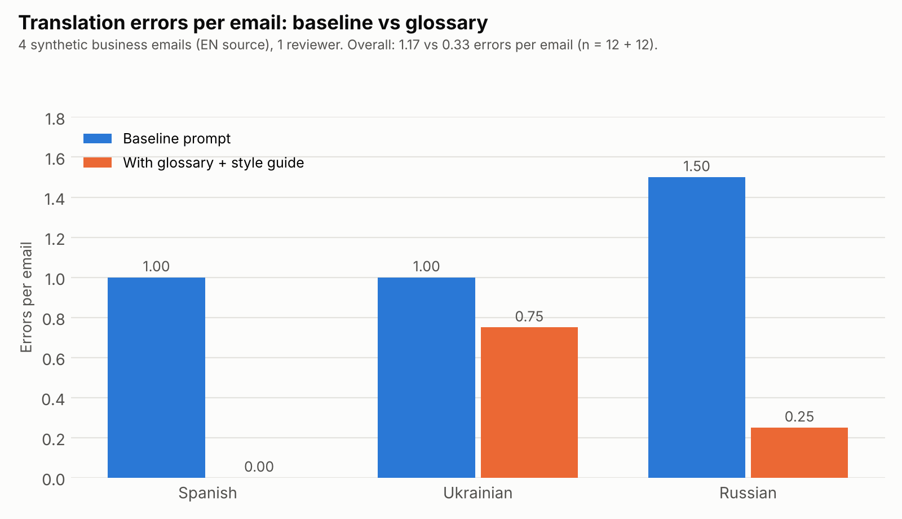

# Report: AI translation of business emails with and without a glossary

## Goal

I wanted to know:

1. Do a glossary and a style guide make AI translations of business emails better?
2. Which errors stay?
3. Can a second AI check find the errors that I find as a human reviewer?

## Method

- 4 synthetic business emails in English (80-110 words): a payment reminder, a delivery delay, a request for documents, a follow-up after a meeting. Two are formal, two are friendly. All contain amounts, dates and numbers.
- Target languages: Spanish (ES), Ukrainian (UK), Russian (RU).
- Two translation prompts:
  - **baseline**: "Translate this email into [language]."
  - **with glossary**: a 30-term glossary, a style guide (form of address, greeting, closing, date and amount format) and rules (keep numbers, do not add or remove information, output only the translation).
- 4 emails x 3 languages x 2 prompts = 24 translations. Every translation in a new chat.
- Model: Claude Sonnet 5.5 (claude.ai chat, medium setting). Date: 23-24 November 2026.
- I reviewed every translation myself and logged each error with a type and a severity.
- Then the same model checked the 12 baseline translations with a QA prompt ([prompts/qa-check-es.md](../prompts/qa-check-es.md)). I compared its findings with mine and gave each extra finding a verdict.

Error types: terminology (word not from the glossary), register (form of address), numbers_dates, omission_or_addition, unnatural.

Severity: 1 = style, the client will not notice; 2 = sounds wrong, but the meaning is clear; 3 = changes the meaning.

## Results: translation

| Metric | Baseline | With glossary |
| --- | --- | --- |
| Translations | 12 | 12 |
| Errors | 14 | 4 |
| **Errors per email** | **1.17** | **0.33** |
| Sum of severity points | 15 | 4 |
| AI comments added after the email | 6 | 0 |
| Number or date errors | 0 | 0 |

Errors by type:

| Error type | Baseline | With glossary |
| --- | --- | --- |
| omission_or_addition | 6 | 1 |
| unnatural | 4 | 2 |
| terminology | 2 | 0 |
| register | 2 | 1 |
| numbers_dates | 0 | 0 |

Errors by language (errors per email):

| Language | Baseline | With glossary |
| --- | --- | --- |
| Spanish | 1.00 | 0.00 |
| Ukrainian | 1.00 | 0.75 |
| Russian | 1.50 | 0.25 |

Full list: [data/error_log.csv](../data/error_log.csv).

## Results: AI quality check

The AI checked the 12 baseline translations.

| Metric | Result |
| --- | --- |
| My errors that the AI also found | **9 of 14 (64%)** |
| My errors that the AI missed | 5 |
| Extra AI findings (not in my log) | 33 |
| - real problems that I had missed | 2 |
| - correct by the rules, but not important for the client | 21 |
| - false alarms | 10 |

What the AI found well: comments added after the email, and words that are not from the glossary.

What the AI missed: style problems that need a native speaker's feeling. For example, "importe íntegro" and "a más tardar" in Spanish, "утром" and the short forms "г-н" / "г-жа" in Russian. The AI even said that "Уважаемая г-жа Видаль!" is correct.

The 2 real problems that I missed: "haga caso omiso de este recordatorio" (ES, sounds curt in a polite reminder) and "господарські витрати" (UK, accounting jargon).

False alarms: for example, "se ven bien" (the AI read it as "look nice", but a Spanish reader understands "are easy to read"), and "antes del viernes 15" (the AI said the deadline moves one day earlier; in practice it does not).

Full list with my verdicts: [data/qa_review.csv](../data/qa_review.csv).

## Findings

1. **The glossary and style guide reduced errors about 3 times** (1.17 → 0.33 per email). Spanish translations with the glossary had no errors.
2. **Half of the baseline errors were comments, not translation errors.** In 6 of 12 baseline translations the AI added a note after the email ("I checked the VAT calculation", "I adapted the amounts"). If the email went to a client automatically, the client would see it. The rule "Output only the translation" removed all of them.
3. **The AI follows the glossary and the style guide exactly, also when they are wrong.** Two of the four glossary errors came from my own files: a wrong Ukrainian vocative in the style guide ("Даніеле" instead of "Даніелю"), and "small receipt = чек" in the glossary, so the word "small" was lost. The baseline translation, without these files, did not have these errors.
4. **Numbers, dates and amounts were always correct**, in both methods. The AI also used the local format (580,80 €, 4 de marzo de 2026) without being asked.
5. **The AI checker is strict but does not know what matters.** It found 64% of my errors and 2 real problems that I missed. But most of its extra findings (21 of 33) followed the rules and were not important for the client, and 10 were false alarms. It is a useful second pair of eyes, not a replacement for a human reviewer.

## Limitations

- Small sample: 4 short emails, 24 translations.
- One reviewer (me). Ukrainian and Russian are my native-level languages, Spanish is fluent but not native. No second reviewer.
- I chose the error types, severity and verdicts myself. Another reviewer could count differently. For example, I did not count most baseline words that are different from the glossary, because the baseline prompt did not include the glossary.
- In one Spanish email the subject used "su" (usted) and the text used "tú". I decided this was not an error.
- The AI check covered only the 12 baseline translations.
- One model only (Claude Sonnet 5.5, medium), for both translation and check. Results can change with another model or version.
- The glossary and the style guide had mistakes, so the "with glossary" result is a bit worse than it could be.
- I did not measure time.

## Recommendations

- Use a glossary and a style guide for client emails in several languages. Errors go down, and the AI stops adding comments.
- A person must check the glossary and the style guide too. Write glossary terms the way professionals say them (for example "receipt without NIF", not "small receipt").
- Use an AI check as a second pair of eyes, but a person decides what is important.
- Keep a human check before sending, especially for tone and natural style.
- For Spanish clients of a gestoría, consider "usted" also in friendly emails (reviewer's preference).
